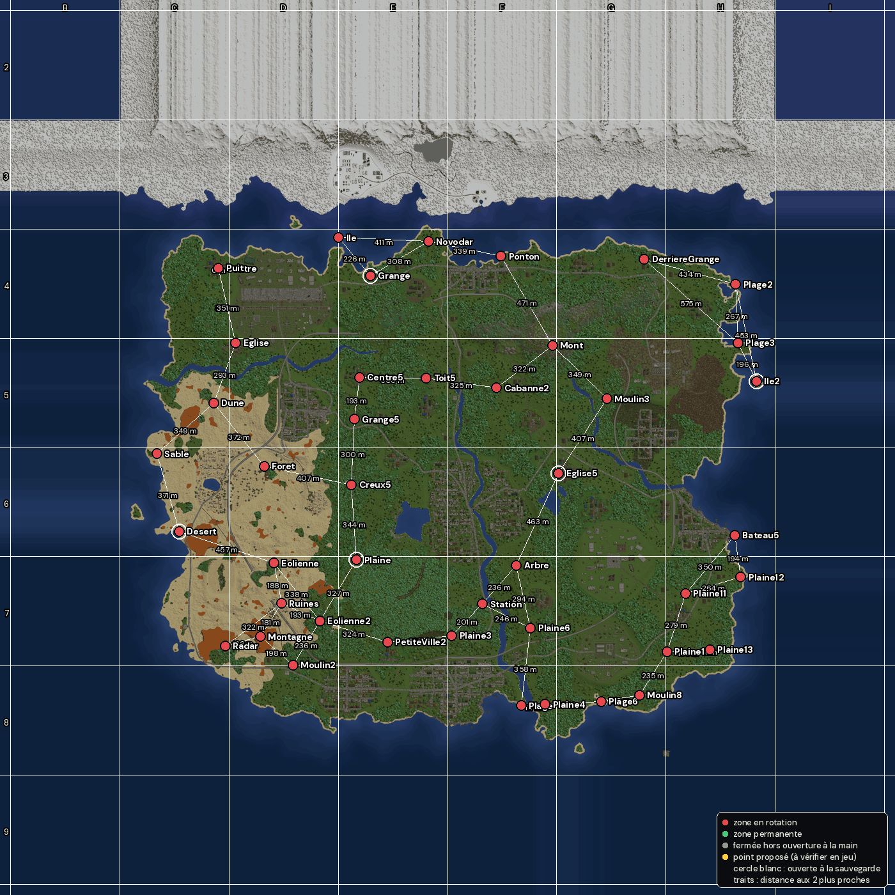
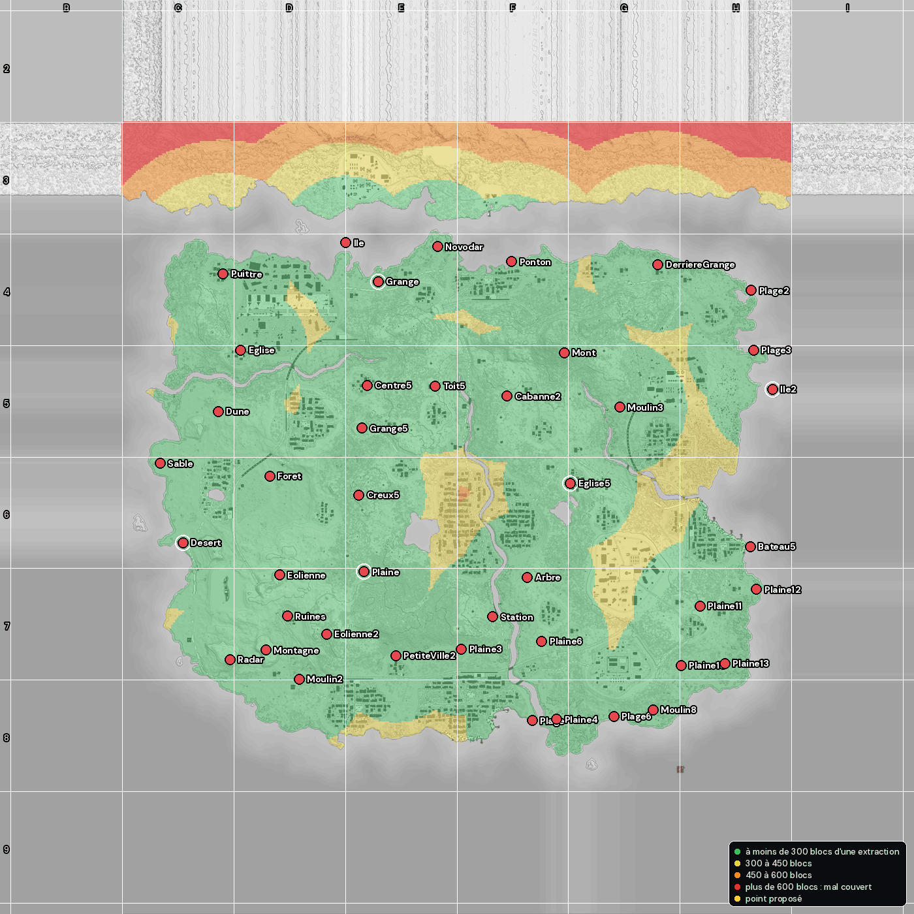

# Extractions de la carte

Fait le 16/10/2026 depuis le monde en service (lecture seule ; rien n'a été écrit sur le serveur).

- **45 zone(s)** posées : 45 en rotation, 0 permanente(s), 0 fermée(s) hors ouverture à la main.
- Réglages de la rotation : 3 à 6 zone(s) ouvertes à la fois, 30 à 60 min, par vagues, distance minimale 800 blocs, une par quart de la carte (absents du fichier du serveur, valeurs du mod 1.5.0 : waves, minDistance, spread).
- Zones ouvertes à la dernière sauvegarde du monde : Desert, Ile2, Plaine, eglise5, grange.

## Les zones

| # | Nom | Affiché | Mode | X | Y | Z | Rayon | À tenir | Carré | Plus proche (distance) | Ouverte |
|---|---|---|---|---:|---:|---:|---:|---:|---|---|---|
| 1 | `Arbre` | Arbre | rotation | 315 | 78 | 539 | 8 | 30 s | F7 | Station (236 m) | non |
| 2 | `Centre` | Centre | rotation | -1048 | 64 | -821 | 8 | 30 s | C4 | Puit (0 m) | non |
| 3 | `DerriereGrange` | DerriereGrange | rotation | 900 | 64 | -863 | 8 | 30 s | G4 | Plage2 (434 m) | non |
| 4 | `Desert` | Desert | rotation | -1228 | 64 | 384 | 8 | 30 s | C6 | Sable (371 m) | oui |
| 5 | `Dune` | Dune | rotation | -1071 | 74 | -205 | 8 | 30 s | C5 | Eglise (293 m) | non |
| 6 | `Eglise` | Eglise | rotation | -969 | 81 | -480 | 5 | 30 s | D5 | Dune (293 m) | non |
| 7 | `Eolienne` | Eolienne | rotation | -795 | 101 | 529 | 8 | 30 s | D7 | Ruines (188 m) | non |
| 8 | `Eolienne2` | Eolienne2 | rotation | -584 | 97 | 794 | 5 | 30 s | D7 | Ruines (193 m) | non |
| 9 | `Foret` | Foret | rotation | -839 | 69 | 85 | 8 | 30 s | D6 | Dune (372 m) | non |
| 10 | `Ile` | Ile | rotation | -499 | 64 | -961 | 8 | 30 s | E4 | grange (226 m) | non |
| 11 | `Ile2` | Ile2 | rotation | 1414 | 64 | -304 | 8 | 30 s | H5 | Plage3 (196 m) | oui |
| 12 | `Mont` | Mont | rotation | 479 | 172 | -469 | 8 | 30 s | F5 | cabanne2 (322 m) | non |
| 13 | `Montagne` | Montagne | rotation | -857 | 96 | 865 | 8 | 30 s | D7 | Radar (166 m) | non |
| 14 | `Moulin2` | Moulin2 | rotation | -707 | 65 | 995 | 5 | 30 s | D7 | Montagne (198 m) | non |
| 15 | `Moulin3` | Moulin3 | rotation | 729 | 69 | -224 | 8 | 30 s | G5 | Mont (349 m) | non |
| 16 | `Moulin8` | Moulin8 | rotation | 878 | 65 | 1132 | 7 | 30 s | G8 | Plage6 (178 m) | non |
| 17 | `Novodar` | Novodar | rotation | -88 | 65 | -943 | 5 | 30 s | E4 | grange (308 m) | non |
| 18 | `PetiteVille2` | PetiteVille2 | rotation | -275 | 64 | 889 | 8 | 30 s | E7 | Plaine3 (295 m) | non |
| 19 | `Plage` | Plage | rotation | 336 | 65 | 1181 | 7 | 30 s | F8 | Plaine4 (111 m) | non |
| 20 | `Plage2` | Plage2 | rotation | 1318 | 64 | -747 | 8 | 30 s | H4 | Plage3 (267 m) | non |
| 21 | `Plage3` | Plage3 | rotation | 1329 | 64 | -480 | 8 | 30 s | H5 | Ile2 (196 m) | non |
| 22 | `Plage6` | Plage6 | rotation | 702 | 64 | 1161 | 7 | 30 s | G8 | Moulin8 (178 m) | non |
| 23 | `Plaine` | Plaine | rotation | -417 | 81 | 513 | 8 | 30 s | E7 | Eolienne2 (327 m) | oui |
| 24 | `Plaine1` | Plaine1 | rotation | 1200 | 66 | 925 | 8 | 30 s | H7 | Plaine13 (0 m) | non |
| 25 | `Plaine10` | Plaine10 | rotation | 1003 | 64 | 934 | 7 | 30 s | H7 | Plaine1 (196 m) | non |
| 26 | `Plaine11` | Plaine11 | rotation | 1089 | 88 | 668 | 7 | 30 s | H7 | Plaine12 (264 m) | non |
| 27 | `Plaine12` | Plaine12 | rotation | 1342 | 64 | 593 | 7 | 30 s | H7 | bateau5 (194 m) | non |
| 28 | `Plaine13` | Plaine13 | rotation | 1200 | 66 | 925 | 8 | 30 s | H7 | Plaine1 (0 m) | non |
| 29 | `Plaine3` | Plaine3 | rotation | 20 | 67 | 860 | 8 | 30 s | F7 | Station (201 m) | non |
| 30 | `Plaine4` | Plaine4 | rotation | 447 | 64 | 1175 | 8 | 30 s | F8 | Plage (111 m) | non |
| 31 | `Plaine6` | Plaine6 | rotation | 380 | 79 | 825 | 8 | 30 s | F7 | Station (246 m) | non |
| 32 | `Ponton` | Ponton | rotation | 244 | 63 | -876 | 4 | 30 s | F4 | Novodar (339 m) | non |
| 33 | `Puit` | Puit | rotation | -1048 | 66 | -821 | 8 | 30 s | C4 | Centre (0 m) | non |
| 34 | `Radar` | Radar | rotation | -1018 | 99 | 907 | 5 | 30 s | C7 | Montagne (166 m) | non |
| 35 | `Ruines` | Ruines | rotation | -760 | 72 | 713 | 5 | 30 s | D7 | Montagne (181 m) | non |
| 36 | `Sable` | Sable | rotation | -1331 | 64 | 28 | 8 | 30 s | C6 | Dune (349 m) | non |
| 37 | `Station` | Station | rotation | 159 | 66 | 716 | 5 | 30 s | F7 | Plaine3 (201 m) | non |
| 38 | `bateau5` | Bateau5 | rotation | 1315 | 63 | 401 | 4 | 30 s | H6 | Plaine12 (194 m) | non |
| 39 | `cabanne2` | Cabanne2 | rotation | 224 | 88 | -273 | 3 | 30 s | F5 | Mont (322 m) | non |
| 40 | `centre5` | Centre5 | rotation | -404 | 76 | -321 | 6 | 30 s | E5 | grange5 (193 m) | non |
| 41 | `creux5` | Creux5 | rotation | -440 | 80 | 170 | 5 | 30 s | E6 | grange5 (300 m) | non |
| 42 | `eglise5` | Eglise5 | rotation | 507 | 85 | 117 | 5 | 30 s | G6 | Moulin3 (407 m) | oui |
| 43 | `grange` | Grange | rotation | -354 | 70 | -787 | 4 | 30 s | E4 | Ile (226 m) | oui |
| 44 | `grange5` | Grange5 | rotation | -428 | 88 | -130 | 4 | 30 s | E5 | centre5 (193 m) | non |
| 45 | `toit5` | Toit5 | rotation | -98 | 103 | -318 | 8 | 30 s | E5 | centre5 (306 m) | non |

## Répartition

- Distance à la voisine la plus proche : 0 m au plus près, 201 m en médiane, 434 m au plus loin.
- **Zones au même endroit** (une seule suffit, retirer l'autre avec `/extraction remove <nom>`) : `Centre` et `Puit`, `Plaine1` et `Plaine13`.
- Bordure du monde : x -1500 à 1500, z -1500 à 1500 ; toutes les zones sont dedans.
- Quarts de la carte (autour du centre des zones en rotation, x 20, z 384, comme le serveur) : nord-ouest 13, nord-est 9, sud-ouest 9, sud-est 14.
- Couverture : **3 %** de la terre de la carte est à plus de 600 blocs de toute extraction (rotation et permanentes) ; 3 % en ne comptant que la rotation. Avec les points proposés : 3 %. Voir la [carte de couverture](couverture.png).

## Le tirage du serveur (simulé)

2000 vagues de 6 zones tirées comme le fait le serveur (HeraliZ Extraction 1.5.0, `Repartition`) avec les zones en rotation d'aujourd'hui :

- distance minimale de 800 blocs tenue : 100 % des vagues ; distance tenue en médiane 800 blocs, au pire 800 blocs ;
- une zone par quart tenue : 100 % ; aucune zone de la vague précédente reprise : 100 % ; vagues complètes : 100 % ;
- meilleure distance possible entre 6 zones ouvertes ensemble : **1181 blocs** (Ile2, Centre, Ponton, Plaine1, Desert, Plaine3).
- ouvertures par zone (sur 2000 vagues, 201 en moyenne) : la plus tirée `Plage3` 235 fois, la moins tirée `Plaine6` 181 fois ;

## Points proposés pour combler les trous

Choisis un par un là où la carte est le plus loin de toute extraction (au moins 600 blocs), à 200 blocs au moins du bord ; méthode : hauteurs lues dans la copie du monde (sol à sec, à ciel ouvert, pente faible sur 24 blocs). **Tous à vérifier en jeu** avant de les créer (accès, pas dans une zone dangereuse ni un bâtiment, endroit intéressant). Un point qui ne va pas : en choisir un autre près de lui et taper `/extraction create <nom>` debout à cet endroit.

Aucun : partout sur la carte, une extraction est à moins de 600 blocs.

Rien n'a été testé en jeu.
